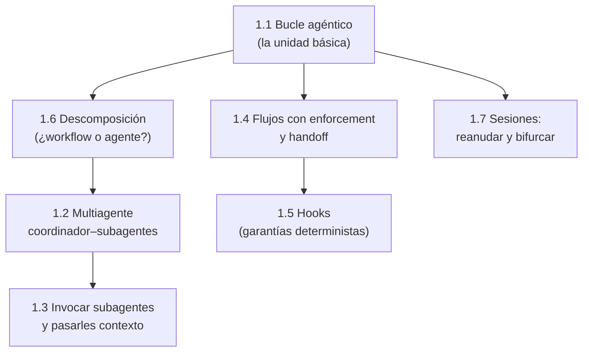
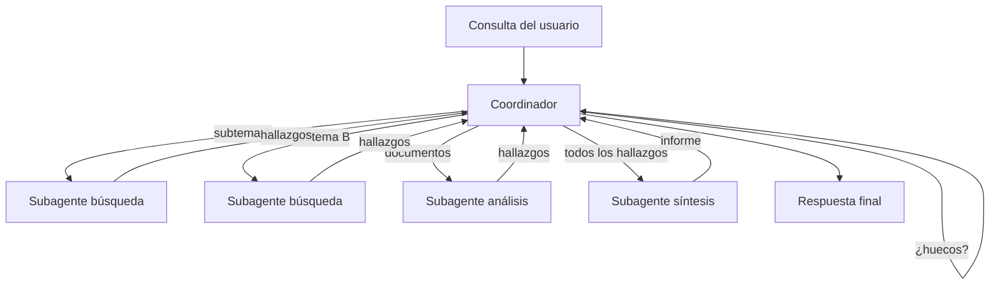

# Dominio 1 · Arquitectura agéntica y orquestación (27 %)

> Síntesis didáctica de los conceptos del Dominio 1 de la guía oficial del examen **Claude Certified Architect – Foundations** (v1.0). Es el dominio con más peso del examen.
> Fuentes principales: los cursos de Anthropic Academy de la carpeta `Anthropic/` (enlazados como `[[...]]`). Cuando el curso no cubre un punto, se completa con la documentación oficial de Claude Code / Agent SDK y con el artículo de ingeniería *How we built our multi-agent research system*. El índice de recursos por *task statement* está en [[00-index]].

## Cómo usar este documento

Cada sección corresponde a un *task statement* (1.1 a 1.7) y sigue el mismo esquema:

1. **La idea en una frase**: lo que tienes que recordar aunque olvides todo lo demás.
2. **Explicación**: el concepto desarrollado, con ejemplos.
3. **Qué busca el examen**: los razonamientos que la guía premia y las respuestas trampa habituales.
4. **Fuentes**: dónde ampliar.

Al final hay una chuleta de decisiones y preguntas de autoevaluación.

**Nota de nomenclatura.** La guía llama `Task` a la herramienta con la que un agente lanza subagentes. En Claude Code actual se llama `Agent` (desde la v2.1.63); `Task` sigue apareciendo en el mensaje `system:init` del SDK. En el examen, `Task` = `Agent`.

### El mapa del dominio

Antes de entrar en detalle, conviene ver cómo encajan las piezas:



Todo parte de una misma idea: **un agente es Claude dentro de un bucle que usa herramientas**. El resto del dominio trata de cómo descomponer el trabajo (uno o varios agentes, flujo fijo o dinámico), cómo garantizar que se cumplen las reglas de negocio (hooks frente a prompts) y cómo conservar el estado entre ejecuciones (sesiones).

---

## 1.1 Diseñar e implementar bucles agénticos

### La idea en una frase

Un agente es Claude en un bucle: **envías mensajes con herramientas → miras `stop_reason` → si es `tool_use`, ejecutas las herramientas y devuelves los resultados → repites hasta `end_turn`**. Tú controlas el bucle y las herramientas; Claude controla el razonamiento.

### Explicación

**Qué es un agente.** El curso *Claude Platform 101* lo define como «una versión autónoma de Claude que gestiona ambos lados del ciclo de mensajería sin intervención humana». Recibe una tarea, elige una herramienta y la ejecuta en bucle hasta que **Claude** decide que ha terminado.

**El ciclo de vida, paso a paso:**

1. Envías a la API los mensajes junto con la lista de herramientas (`tools`): nombre, descripción y JSON Schema de la entrada.
2. Claude responde. El campo `stop_reason` te dice por qué se ha detenido:
   - `tool_use`: quiere que ejecutes una o varias herramientas. La respuesta contiene bloques `tool_use` con `id`, `name` e `input`.
   - `end_turn`: ha terminado y la respuesta es definitiva.
3. Si es `tool_use`, tu código ejecuta cada herramienta solicitada.
4. Añades al historial **dos mensajes**: la respuesta completa del asistente (con sus bloques `tool_use`) y un mensaje `user` con un bloque `tool_result` por cada llamada, enlazado mediante `tool_use_id`.
5. Vuelves al paso 1 con el historial ampliado.

El ejemplo mínimo del curso (una herramienta ficticia `get_weather`):

```python
while True:
    response = client.messages.create(
        model="claude-sonnet-5", max_tokens=1024,
        tools=tools, messages=messages,
    )

    if response.stop_reason == "end_turn":      # Claude ha terminado
        print(next(b.text for b in response.content if b.type == "text"))
        break

    if response.stop_reason == "tool_use":      # Claude pide herramientas
        tool_results = []
        for block in response.content:
            if block.type == "tool_use":
                result = run_tool(block.name, block.input)
                tool_results.append({
                    "type": "tool_result",
                    "tool_use_id": block.id,     # enlaza resultado con petición
                    "content": result,
                })
        # El historial crece: respuesta del asistente + resultados
        messages.append({"role": "assistant", "content": response.content})
        messages.append({"role": "user", "content": tool_results})
```

Al ejecutarlo hay dos vueltas: en la primera `stop_reason` es `tool_use` (pide el tiempo de Austin); en la segunda es `end_turn` (recomienda ropa ligera).

**Por qué el historial es la memoria del agente.** La API no guarda estado: cada petición debe llevar la conversación completa. Si no añades los `tool_result`, Claude no «ve» lo que ha descubierto y no puede razonar sobre el siguiente paso. Fíjate en tres detalles del curso *Creación con la API de Claude*:

- Una respuesta puede tener **varios bloques** (texto + uno o más `tool_use`). Hay que guardar el `content` completo, no solo el texto.
- Si Claude pide varias herramientas en una sola respuesta, devuelves **todos** los `tool_result` en **un único** mensaje `user`.
- Si una herramienta falla, devuelves el error en el `tool_result` (con `is_error: true`) para que Claude pueda adaptarse, en lugar de romper el bucle.

**Decisión dirigida por el modelo frente a secuencias prefijadas.** En un agente, **Claude decide** qué herramienta usar a continuación según el contexto. En un árbol de decisión o una secuencia fija, lo decide **tu código**. Ninguna es mejor en abstracto (lo veremos en 1.6), pero en un bucle agéntico la decisión es del modelo.

**El mismo bucle en producción.** Un agente real (por ejemplo, uno de cumplimiento normativo que lee un informe, consulta normativa y registra riesgos) tiene la misma estructura; solo cambian las herramientas y la infraestructura. El **Agent SDK** ejecuta este mismo bucle por ti: cada vuelta con herramientas es un *turn*, y el bucle acaba cuando Claude responde sin pedir herramientas. Termina con un `ResultMessage` cuyo `subtype` indica cómo acabó (`success`, `error_max_turns`, `error_max_budget_usd`...).

### Qué busca el examen

La guía señala tres **antipatrones** para decidir cuándo parar:

| Antipatrón | Por qué está mal | Lo correcto |
|---|---|---|
| Parsear lenguaje natural («he terminado», «tarea completada») | El texto es ambiguo y frágil | Mirar `stop_reason` |
| Un tope arbitrario de iteraciones como mecanismo **principal** de parada | Corta tareas legítimas a medias o deja correr las malas | `stop_reason` como criterio; el tope (`max_turns`, `max_budget_usd`) solo como red de seguridad |
| Usar la presencia de texto del asistente como señal de fin | Claude puede escribir texto **y** pedir una herramienta en la misma respuesta | Mirar `stop_reason` |

Matiz importante: los límites de turnos y presupuesto **sí** son buena práctica en producción (la documentación del SDK recomienda un presupuesto por defecto), pero como **red de seguridad**, no como la forma normal de terminar.

Otros `stop_reason` que conviene reconocer: `max_tokens` (se cortó por longitud; la respuesta está incompleta), `stop_sequence`, `pause_turn` y `refusal`.

### Fuentes

- Claude Platform 101 › Teaching your agent › [The agent loop explained](https://academy.claude.com/courses/claude-platform-101/the-agent-loop-explained)
- Building with the Claude API › Tool use with Claude  › [Handling message blocks](https://academy.claude.com/courses/building-with-the-claude-api/handling-message-blocks)
- Building with the Claude API › Tool use with Claude  › [Sending tool results](https://academy.claude.com/courses/building-with-the-claude-api/sending-tool-results)
- Building with the Claude API › Tool use with Claude  › [Implementing multiple turns](https://academy.claude.com/courses/building-with-the-claude-api/implementing-multiple-turns)
- Docs: [Agent SDK  How the agent loop works](https://code.claude.com/docs/en/agent-sdk/agent-loop) · [Handling stop reasons](https://platform.claude.com/docs/en/build-with-claude/handling-stop-reasons)

---

## 1.2 Orquestar sistemas multiagente con el patrón orchestrator-worker

### La idea en una frase

Un **coordinador** descompone la tarea, decide qué subagentes lanzar, les delega trabajo con instrucciones claras y sintetiza sus resultados. Toda la comunicación pasa por él (*hub-and-spoke*), y cada subagente trabaja en un **contexto aislado**.

### Explicación

**Qué es un subagente.** El curso *Introducción a subagentes* los describe como «asistentes especializados» que se ejecutan en su propia ventana de contexto, hacen su trabajo y devuelven **solo un resumen**. Las lecturas de archivos, búsquedas y llamadas a herramientas intermedias se quedan en el subagente y se descartan al terminar.

Un subagente recibe exactamente dos cosas:

- Su **system prompt** (definido en su configuración).
- La **descripción de la tarea** que escribe el agente principal al delegar.

No hereda el historial del coordinador. Volveremos sobre esto en 1.3.

**Arquitectura *hub-and-spoke*.** El coordinador es el centro y los subagentes son los radios. Los subagentes no hablan entre sí; todo pasa por el coordinador. Esto aporta tres cosas que la guía menciona explícitamente:

- **Observabilidad**: un solo punto donde ver qué se delegó y qué volvió.
- **Gestión de errores coherente**: el coordinador decide si reintentar, buscar alternativas o seguir con resultados parciales.
- **Flujo de información controlado**: el coordinador decide qué contexto recibe cada subagente.



**Las cuatro responsabilidades del coordinador:**

1. **Descomponer** la consulta en subtareas.
2. **Delegar**: elegir qué subagentes invocar y con qué instrucciones.
3. **Agregar** los resultados.
4. **Decidir según la complejidad**: no todas las consultas necesitan todo el pipeline. El artículo de ingeniería de Anthropic sobre su sistema de investigación da cifras orientativas: una búsqueda de un dato simple usa 1 agente con 3–10 llamadas a herramientas; una comparación directa, 2–4 subagentes; una investigación compleja, más de 10 subagentes con responsabilidades divididas. Uno de los fallos observados fue precisamente «lanzar 50 subagentes para consultas simples».

**El riesgo de una descomposición demasiado estrecha.** Si el coordinador divide mal el problema, los subagentes harán bien un trabajo incompleto. La guía lo ilustra con un caso: el tema es «impacto de la IA en las industrias creativas» y el coordinador lo divide en «arte digital», «diseño gráfico» y «fotografía». Cada subagente cumple, pero el informe ignora música, escritura y cine. **La causa raíz es el coordinador, no los subagentes.**

**Repartir el alcance para evitar duplicados.** El artículo de Anthropic cuenta que, con instrucciones vagas, varios subagentes investigaban lo mismo (dos sobre la cadena de suministro de 2025) mientras quedaban huecos. La solución es dar a cada subagente un subtema o un tipo de fuente distinto, con **límites claros**.

**Bucles de refinamiento iterativo.** El coordinador no se limita a sintetizar una vez: evalúa la síntesis, detecta huecos, vuelve a delegar con consultas concretas y re-sintetiza hasta que la cobertura es suficiente. Es el patrón *evaluator-optimizer* del curso de la API aplicado a la orquestación: un productor genera, un evaluador valora según criterios y, si no acepta, devuelve *feedback* hasta que el resultado pasa.

**Cuándo merece la pena (y cuándo no).** Según el artículo de Anthropic, su sistema multiagente superó en un 90,2 % a un único agente en su evaluación interna de investigación, pero consume unas **15 veces más tokens** que un chat. Encaja con tareas valiosas y muy paralelizables (investigación amplia). Encaja peor con tareas de programación, que tienen menos partes independientes.

### Qué busca el examen

- Si la salida final tiene huecos de cobertura y los subagentes funcionan bien, **mira la descomposición del coordinador**.
- El coordinador debe **elegir dinámicamente** qué subagentes invocar según la consulta, en lugar de pasar siempre por todo el pipeline.
- La comunicación entre subagentes **pasa por el coordinador**. Las opciones que conectan subagentes entre sí directamente pierden observabilidad.
- **Mínimo privilegio** (pregunta 9 de la guía): si el agente de síntesis necesita verificar datos simples el 85 % de las veces, dale una herramienta acotada (`verify_fact`) y mantén las verificaciones complejas a través del coordinador. Darle todas las herramientas de búsqueda viola la separación de responsabilidades.

### Fuentes

- Introduction to subagents › [What are subagents?](https://academy.claude.com/courses/introduction-to-subagents/what-are-subagents)
- Building with the Claude API › Agents and workflows › [Workflows vs agents](https://academy.claude.com/courses/building-with-the-claude-api/workflows-vs-agents)
- Building with the Claude API › Agents and workflows › [Agents and workflows](https://academy.claude.com/courses/building-with-the-claude-api/agents-and-workflows) (patrón *evaluator-optimizer*)
- Artículo: [How we built our multi-agent research system](https://www.anthropic.com/research/multi-agent-research-system) (la fuente principal para el escenario 3 del examen)
- Docs: [Agent SDK › Subagents](https://code.claude.com/docs/en/agent-sdk/subagents)

---

## 1.3 Invocar subagentes, pasarles contexto y lanzarlos

### La idea en una frase

Los subagentes se lanzan con la herramienta `Task`/`Agent`, se configuran con un `AgentDefinition` y **solo saben lo que pongas en su prompt**. Si necesitan hallazgos previos, tienes que pasárselos completos y estructurados.

### Explicación

**El mecanismo: la herramienta `Task` (hoy `Agent`).** El coordinador lanza un subagente llamando a esta herramienta, igual que llama a cualquier otra. En el Agent SDK:

```python
options = ClaudeAgentOptions(
    allowed_tools=["Read", "Grep", "Glob", "Agent"],   # la guía: debe incluir "Task"
    agents={
        "code-reviewer": AgentDefinition(
            description="Expert code review specialist. Use for quality and security reviews.",
            prompt="You are a code review specialist...",   # system prompt
            tools=["Read", "Grep", "Glob"],                 # restricción de herramientas
            model="sonnet",
        ),
    },
)
```

**Para el examen:** la guía v1.0 dice que `allowedTools` **debe incluir `"Task"`** para que el coordinador pueda invocar subagentes. Es la respuesta esperada.
**Matiz de la versión actual:** en el SDK actual, `allowedTools` solo **autoaprueba** herramientas; `Agent` no pide aprobación y está disponible aunque no la listes. Para quitársela al agente se usa `disallowedTools`. Los ejemplos oficiales siguen poniendo `"Agent"` en `allowedTools`.

**`AgentDefinition`: los tres campos clave.**

| Campo | Para qué sirve |
|---|---|
| `description` | Cuándo usar el subagente. El coordinador ve el nombre y la descripción de todos los subagentes y decide con eso. |
| `prompt` | El system prompt: rol, criterios y **formato de salida**. |
| `tools` | Qué herramientas puede usar. Si lo omites, hereda todas. |

Hay más (`model`, `skills`, `maxTurns`, `effort`...), pero esos tres son los que pide la guía. En Claude Code, el equivalente es un archivo Markdown en `.claude/agents/` con *frontmatter* YAML (`name`, `description`, `tools`, `model`) y el system prompt en el cuerpo.

El curso añade un detalle útil: la **descripción tiene dos funciones**. Decide *cuándo* se lanza el subagente y también orienta *qué le pide* el coordinador, porque este la usa como guía para redactar el prompt de entrada. Si la descripción de un subagente de búsqueda dice «devuelve fuentes que puedan citarse», el coordinador incluirá esa instrucción al delegar.

**El contexto se pasa de forma explícita.** Esta es la idea más importante de la sección. Un subagente (salvo que sea un *fork*) arranca con:

| Recibe | No recibe |
|---|---|
| Su system prompt (`AgentDefinition.prompt`) y el prompt de la herramienta `Agent` | El historial del coordinador ni sus resultados de herramientas |
| El `CLAUDE.md` del proyecto | El system prompt del coordinador |
| Las definiciones de sus herramientas | Memoria compartida con otras invocaciones |

En palabras de la documentación: «lo único que pasas del padre al subagente es el prompt de la herramienta Agent, así que incluye directamente en ese prompt las rutas de archivo, mensajes de error o decisiones que el subagente necesite».

**Pasar hallazgos completos y estructurados.** Si el subagente de síntesis tiene que combinar los resultados de búsqueda y análisis, esos resultados deben ir **en su prompt**, completos. Y conviene **separar el contenido de los metadatos** para no perder la atribución:

```xml
<finding>
  <claim>El 60 % de los estudios de animación usa IA generativa en preproducción.</claim>
  <source_url>https://ejemplo.org/informe-2026</source_url>
  <document>Informe anual de animación 2026</document>
  <page>14</page>
</finding>
```

Así, el subagente de síntesis puede citar cada afirmación con su fuente. Las etiquetas XML son la técnica del curso de la API para estructurar contenido dentro de un prompt.

**Diseñar la salida del subagente.** El curso insiste en que la mejora más importante para un subagente es **definir un formato de salida** en su system prompt. Le da un punto natural de finalización (sabe que ha terminado cuando completa todas las secciones) y evita que trabaje más de la cuenta. Recomienda añadir una sección de **«Obstáculos encontrados»** para que el coordinador no tenga que redescubrir soluciones (flags especiales, problemas de dependencias, particularidades del entorno).

**Subagentes en paralelo: varias llamadas en una sola respuesta.** Para que varios subagentes trabajen a la vez, el coordinador debe emitir **varias llamadas `Task` en la misma respuesta**, no una por turno. Es el mismo mecanismo que el uso de varias herramientas en paralelo (*parallel tool use*): Claude devuelve varios bloques `tool_use` y el sistema los ejecuta a la vez. El artículo de Anthropic cuenta que el paralelismo (3–5 subagentes a la vez, y cada uno con 3 o más herramientas en paralelo) redujo el tiempo de investigación hasta un 90 % en consultas complejas.

**Prompts del coordinador: objetivos y criterios, no pasos.** Un buen prompt de delegación especifica:

- El **objetivo** de la investigación.
- El **formato de salida** esperado.
- **Orientación** sobre herramientas y fuentes.
- **Límites** claros de la tarea.
- **Criterios de calidad** (qué cuenta como suficiente).

No dicta los pasos uno a uno: el subagente necesita margen para adaptarse a lo que encuentre.

**Sesiones *fork*.** Un *fork* es un subagente (o una sesión) que **copia** la conversación hasta ese punto en lugar de empezar de cero. Sirve para explorar enfoques divergentes desde una base de análisis común. Se trata en detalle en 1.7.

### Qué busca el examen

- Si un subagente «no sabe» algo que el coordinador sí sabía, la respuesta es **pasarlo explícitamente en el prompt**, no esperar que lo herede.
- Paralelismo = **varias llamadas `Task` en una misma respuesta**. Lanzarlas en turnos separados las hace secuenciales.
- Prompts del coordinador con **objetivos y criterios de calidad**. Las opciones con instrucciones procedimentales paso a paso suelen ser incorrectas.
- Datos con **metadatos separados** (URL, documento, página) para preservar la atribución.

### Fuentes

- Introduction to subagents › [Creating a subagent](https://academy.claude.com/courses/introduction-to-subagents/creating-a-subagent)
- Introduction to subagents › [Designing effective subagents](https://academy.claude.com/courses/introduction-to-subagents/designing-effective-subagents)
- Building with the Claude API › Prompt engineering techniques › [Structure with XML tags](https://academy.claude.com/courses/building-with-the-claude-api/structure-with-xml-tags)
- Building with the Claude API › Tool use with Claude › [Using multiple tools](https://academy.claude.com/courses/building-with-the-claude-api/using-multiple-tools)
- Docs: [Agent SDK › Subagents](https://code.claude.com/docs/en/agent-sdk/subagents) (secciones *AgentDefinition configuration* y *What subagents inherit*) · [Permissions › Allow and deny rules](https://code.claude.com/docs/en/agent-sdk/permissions#allow-and-deny-rules)

---

## 1.4 Flujos multipaso con *enforcement* y *handoff*

### La idea en una frase

Cuando un orden de pasos es **obligatorio** (verificar la identidad antes de reembolsar), no basta con pedirlo en el prompt: hay que **imponerlo con código**. Y cuando el agente escala a un humano, debe entregarle un **resumen estructurado**, porque el humano no ve la conversación.

### Explicación

**Prompt frente a *enforcement* programático.** Los cursos de Claude Code lo resumen así: una instrucción en el prompt o en `CLAUDE.md` «es una petición, no una garantía». Claude la sigue casi siempre, pero «casi siempre» tiene una **tasa de fallo distinta de cero**. Para la mayoría de las cosas es suficiente; para operaciones con consecuencias financieras, legales o de seguridad, no.

| | Guía por prompt | *Enforcement* programático |
|---|---|---|
| Mecanismo | System prompt, `CLAUDE.md`, *few-shot* | Hooks, *gates* de prerrequisitos en el código |
| Naturaleza | Probabilística | Determinista |
| Úsalo para | Preferencias, estilo, orientación | Reglas de negocio que **deben** cumplirse siempre |

**Prerrequisitos que bloquean herramientas.** El caso típico del examen: un agente de soporte a veces llama a `lookup_order` o `process_refund` sin haber llamado antes a `get_customer`, y acaba reembolsando a la cuenta equivocada. La solución es un **gate**: bloquear `process_refund` hasta que `get_customer` haya devuelto un ID de cliente verificado. Un esquema con hooks del Agent SDK (ejemplo ilustrativo):

```python
verified_customers = set()

async def record_verification(input_data, tool_use_id, context):
    # PostToolUse sobre get_customer: guarda el ID verificado
    customer_id = input_data["tool_response"].get("customer_id")
    if customer_id:
        verified_customers.add(customer_id)
    return {}

async def require_verified_customer(input_data, tool_use_id, context):
    # PreToolUse sobre process_refund: bloquea si no hay verificación
    customer_id = input_data["tool_input"].get("customer_id")
    if customer_id not in verified_customers:
        return {"hookSpecificOutput": {
            "hookEventName": "PreToolUse",
            "permissionDecision": "deny",
            "permissionDecisionReason": "Verifica primero al cliente con get_customer.",
        }}
    return {}

options = ClaudeAgentOptions(hooks={
    "PostToolUse": [HookMatcher(matcher="mcp__support__get_customer", hooks=[record_verification])],
    "PreToolUse":  [HookMatcher(matcher="mcp__support__process_refund", hooks=[require_verified_customer])],
})
```

El motivo del `deny` llega a Claude como resultado de la herramienta, así que el agente entiende qué le falta y puede corregir el rumbo.

> **Qué es un *gate*.** Un *gate* (compuerta o barrera) es una comprobación en el código que impide un paso mientras no se cumpla una condición previa. El agente no puede saltársela, aunque quiera o se equivoque.
>
> - **El problema.** Si el *system prompt* dice «verifica siempre al cliente con `get_customer` antes de reembolsar», Claude lo cumplirá casi siempre, pero ese «casi» deja una tasa de fallo distinta de cero. En la pregunta 1 de la guía, el agente se salta la verificación en un 12 % de los casos y reembolsa a la cuenta equivocada. Con dinero o cumplimiento normativo de por medio, «casi siempre» no basta.
> - **Cómo funciona.** El orden ya no se le pide al modelo: lo impone el código. (1) Cuando `get_customer` devuelve un cliente verificado, un hook `PostToolUse` lo anota en `verified_customers`. (2) Cuando Claude intenta llamar a `process_refund`, un hook `PreToolUse` comprueba la lista; si el cliente no está, devuelve `deny` y el reembolso no se ejecuta. (3) El motivo del rechazo le llega a Claude como resultado de la herramienta, así que entiende qué le falta, llama a `get_customer` y vuelve a intentarlo.
> - **Una analogía.** Es como el torno del metro: un cartel que dice «pague antes de pasar» es el prompt; el torno, que impide pasar sin pagar, es el *gate*.
> - **Para el examen.** Si el enunciado habla de algo que debe cumplirse siempre, de forma obligatoria o garantizada, la respuesta es un *gate* o un hook programático. Mejorar el prompt, añadir *few-shot* o usar un clasificador no sirve, porque siguen siendo probabilísticos. `tool_choice` tampoco: fuerza qué herramienta se llama en un turno, pero no impone un orden de negocio a lo largo de la conversación.

**Peticiones con varios asuntos: descomponer, investigar en paralelo, sintetizar.** Si un cliente escribe «mi pedido llegó roto, además me cobraron dos veces y quiero cambiar la dirección», el agente debe:

1. Separar los asuntos en elementos distintos.
2. Investigar cada uno **en paralelo**, compartiendo el contexto común (cliente, pedido).
3. Sintetizar **una resolución unificada**.

Es el patrón de **paralelización** del curso de la API: dividir una tarea en subtareas independientes, ejecutarlas a la vez y agregarlas. Ventajas que señala el curso: atención enfocada en cada aspecto, optimización independiente de cada parte y resultados más fiables.

**Protocolos de *handoff* a humanos.** Cuando el agente escala a mitad del proceso, el humano que recibe el caso **no tiene acceso a la transcripción**. El agente debe entregar un resumen estructurado y autosuficiente:

```json
{
  "customer_id": "C-48213",
  "issue_summary": "Producto recibido dañado; solicita reembolso de 640 $",
  "root_cause": "Daño en transporte confirmado por fotos",
  "actions_taken": ["Cliente verificado", "Pedido #12345 consultado"],
  "refund_amount": 640.00,
  "blocked_by": "Importe superior al límite autónomo de 500 $",
  "recommended_action": "Aprobar reembolso completo y abrir reclamación al transportista"
}
```

La guía pide expresamente: datos del cliente, análisis de la causa raíz y acciones recomendadas (y, en el caso de reembolsos, el importe).

### Qué busca el examen

- **Pregunta 1 de la guía**: si el agente se salta un paso obligatorio el 12 % de las veces, la respuesta correcta es el **prerrequisito programático**. Mejorar el system prompt o añadir *few-shot* siguen siendo probabilísticos. Un clasificador de enrutado resuelve qué herramientas están disponibles, no **el orden** en que se usan.
- Distingue **disponibilidad** de herramientas (qué puede usar) y **orden** (cuándo puede usarla).
- En un *handoff*, la respuesta correcta siempre incluye un resumen estructurado y autosuficiente; enviar «la transcripción completa» o «un resumen libre» son distractores habituales.

### Fuentes

- Claude Code in action › Configure Claude › [Hooks](https://academy.claude.com/courses/claude-code-in-action/hooks)
- Claude Code 101 › Customizing Claude Code › [Hooks](https://academy.claude.com/courses/claude-code-101/hooks)(«una petición, no una garantía»)
- Building with the Claude API › Agents and workflows › [Parallelization workflows](https://academy.claude.com/courses/building-with-the-claude-api/parallelization-workflows)
- Docs: [Agent SDK › Hooks](https://code.claude.com/docs/en/agent-sdk/hooks)

---

## 1.5 Hooks del Agent SDK para interceptar llamadas y normalizar datos

### La idea en una frase

Los hooks son **código tuyo que se ejecuta siempre** en puntos concretos del bucle: `PreToolUse` antes de una herramienta (puede bloquearla o reescribirla) y `PostToolUse` después (puede transformar su resultado antes de que Claude lo lea).

### Explicación

**Por qué hooks.** El curso *Claude Code 101* lo dice sin rodeos: «Si algo necesita ocurrir siempre, sin posibilidad de fallo, no lo pongas únicamente en un prompt. Ponlo en un hook». Los hooks son **deterministas**: se ejecutan en tu proceso, fuera de la ventana de contexto del modelo, y no dependen de que Claude «se acuerde».

**Los dos hooks del examen:**

| Hook | Cuándo se ejecuta | Qué puede hacer |
|---|---|---|
| `PreToolUse` | Antes de ejecutar la herramienta | Permitir, **denegar** (`permissionDecision: "deny"`), pedir confirmación (`"ask"`) o **reescribir** la entrada (`updatedInput`) |
| `PostToolUse` | Después de que la herramienta devuelva su resultado | Añadir contexto (`additionalContext`) o **reemplazar** el resultado (`updatedToolOutput`) antes de que Claude lo vea |

Hay otros eventos (`Stop`, `SubagentStart`/`SubagentStop`, `PreCompact`, `UserPromptSubmit`...), pero el examen se centra en estos dos.

**Cómo se registran en el SDK.** Con la opción `hooks`: un diccionario de evento → lista de *matchers*. El `matcher` filtra por **nombre de herramienta** (las herramientas MCP siguen el patrón `mcp__<servidor>__<acción>`). Cada *callback* recibe los datos del evento (`tool_name`, `tool_input` y, en `PostToolUse`, el resultado), el `tool_use_id` y un contexto.

**Patrón 1: normalizar datos heterogéneos (`PostToolUse`).** Varias herramientas MCP devuelven fechas en formatos distintos (*timestamps* Unix, ISO 8601) y estados como códigos numéricos. En lugar de pedirle a Claude que lo interprete, un hook unifica el formato antes de que el modelo lo procese (ejemplo ilustrativo):

```python
from datetime import datetime, timezone

STATUS = {1: "pending", 2: "shipped", 3: "delivered"}

async def normalize_order(input_data, tool_use_id, context):
    data = dict(input_data["tool_response"])
    if isinstance(data.get("created_at"), (int, float)):          # Unix timestamp
        data["created_at"] = datetime.fromtimestamp(
            data["created_at"], tz=timezone.utc).isoformat()
    if isinstance(data.get("status"), int):                      # código numérico
        data["status"] = STATUS.get(data["status"], "unknown")
    return {"hookSpecificOutput": {
        "hookEventName": "PostToolUse",
        "updatedToolOutput": data,          # Claude solo ve la versión normalizada
    }}

options = ClaudeAgentOptions(hooks={
    "PostToolUse": [HookMatcher(matcher="^mcp__", hooks=[normalize_order])],
})
```

**Patrón 2: bloquear acciones que violan una política y redirigir (`PreToolUse`).** Un reembolso por encima de 500 $ no debe procesarse de forma autónoma. El hook lo deniega y el motivo orienta al agente hacia el flujo alternativo:

```python
async def refund_limit(input_data, tool_use_id, context):
    if input_data["tool_input"].get("amount", 0) > 500:
        return {"hookSpecificOutput": {
            "hookEventName": "PreToolUse",
            "permissionDecision": "deny",
            "permissionDecisionReason":
                "Los reembolsos de más de 500 $ requieren un humano. "
                "Usa escalate_to_human con un resumen del caso.",
        }}
    return {}
```

En vez de bloquear, también puedes **reescribir** la llamada con `updatedInput`. El curso *Claude Code in action* pone el ejemplo de eliminar un secreto (`sk_live_...`) de un comando y dejar que se ejecute. Ojo: `updatedInput` sustituye **toda** la entrada, así que hay que devolver también los campos que no cambian.

**Hooks en Claude Code frente a hooks en el SDK.** La idea es la misma, cambia la forma:

- En **Claude Code**, los hooks son comandos de *shell* configurados en `.claude/settings.json`. Reciben JSON por `stdin` y responden con un código de salida (**2 bloquea**; 1 **no** bloquea, es un error no bloqueante) o con JSON (`permissionDecision`).
- En el **Agent SDK**, son funciones (*callbacks*) que devuelven el mismo formato JSON.

### Qué busca el examen

- **Hooks = garantía determinista; prompt = cumplimiento probabilístico.** Si el enunciado dice «debe cumplirse siempre», «garantizado», «cumplimiento normativo» o hay dinero de por medio, la respuesta es un hook.
- Normalizar formatos de varias fuentes: **`PostToolUse`**, no instrucciones en el prompt para que Claude «interprete» cada formato.
- Bloquear una acción **antes** de que ocurra: **`PreToolUse`**. `PostToolUse` llega tarde para impedir la llamada.
- Bloquear sin más deja al agente atascado; la buena respuesta **redirige** a un flujo alternativo (escalado humano).

### Fuentes

- Claude Code in action › Configure Claude › [Hooks](https://academy.claude.com/courses/claude-code-in-action/hooks)
- Claude Code 101 › Customizing Claude Code › [Hooks](https://academy.claude.com/courses/claude-code-101/hooks) («una petición, no una garantía»)
- Docs: [Agent SDK › Hooks](https://code.claude.com/docs/en/agent-sdk/hooks) (secciones *Outputs* y *Examples*) · [Hooks reference](https://code.claude.com/docs/en/hooks)

---

## 1.6 Estrategias de descomposición de tareas

### La idea en una frase

Si conoces los pasos de antemano, usa un **flujo fijo** (*prompt chaining*): es más fiable y fácil de evaluar. Si los pasos dependen de lo que vayas descubriendo, usa **descomposición dinámica**: un agente que planifica, investiga y adapta el plan.

### Explicación

**Workflows frente a agentes.** Es la distinción central del módulo *Agentes y workflows* del curso de la API:

- Un **workflow** es una serie predefinida de llamadas a Claude para resolver un problema conocido. Se usa cuando puedes visualizar los pasos con antelación.
- Un **agente** recibe un objetivo y herramientas, y descubre cómo cumplirlo.

| | Workflows | Agentes |
|---|---|---|
| Ventajas | Más precisión (una subtarea a la vez), fáciles de evaluar y probar, predecibles | Flexibles, resuelven situaciones no previstas, pueden pedir información al usuario |
| Inconvenientes | Poco flexibles, requieren más diseño previo | Menor tasa de éxito, difíciles de evaluar, menos predecibles |

La recomendación del curso es clara: «céntrate siempre en implementar workflows cuando sea posible y recurre a agentes solo cuando sean realmente necesarios». A los usuarios les importa que el producto funcione de forma consistente, no que el agente sea sofisticado.

**Los cuatro patrones de workflow del curso:**

| Patrón | Qué hace | Cuándo usarlo |
|---|---|---|
| **Encadenamiento** (*chaining*) | Divide la tarea en pasos secuenciales; la salida de uno alimenta al siguiente, con procesamiento por código entre medias si hace falta | Tareas con dependencias lineales; cuando Claude ignora restricciones en prompts largos |
| **Paralelización** | Divide en subtareas independientes, las ejecuta a la vez y agrega los resultados | Decisiones con varios criterios o perspectivas independientes |
| **Enrutamiento** (*routing*) | Clasifica la entrada y la envía a **un** pipeline especializado | Entradas de tipos distintos que necesitan tratamiento distinto |
| **Evaluator-optimizer** | Un productor genera, un evaluador valora y devuelve *feedback* hasta aceptar | Criterios de calidad claros y mejora iterativa demostrable |

**Encadenamiento para revisiones con varios aspectos.** El ejemplo de la guía es una revisión de código: en lugar de analizar 14 archivos de una vez, se hace **una pasada por archivo** (problemas locales) y luego **una pasada de integración** (flujo de datos entre archivos). El motivo es la **dilución de la atención**: con muchos archivos a la vez, el análisis sale desigual, se escapan errores y aparecen contradicciones (marcar un patrón como erróneo en un archivo y aprobarlo en otro). Un modelo con más contexto **no** lo arregla: el problema es la calidad de la atención, no el espacio.

**Descomposición dinámica para tareas abiertas.** Para algo como «añade tests completos a una base de código *legacy*» no puedes conocer los pasos de antemano. El patrón es:

1. **Mapear** la estructura (módulos, dependencias, tests existentes).
2. **Identificar** las áreas de mayor impacto.
3. **Crear un plan priorizado** que se **adapta** a medida que descubres dependencias.

Es el flujo «explorar → planificar → programar → confirmar» del curso *Claude Code 101*, y la estrategia «empieza amplio y luego estrecha» del artículo de Anthropic sobre investigación multiagente.

**Cuándo NO conviene encadenar subagentes.** El curso de subagentes avisa de un antipatrón: los **pipelines secuenciales de subagentes** (uno reproduce un bug, otro lo depura, otro lo arregla) fallan cuando cada paso depende de lo que descubrió el anterior, porque **la información se pierde en cada traspaso**. La regla del curso: **¿importa el trabajo intermedio?** Si solo necesitas el resultado, delega en un subagente; si necesitas ver el proceso y reaccionar, mantenlo en el hilo principal.

### Qué busca el examen

- **Pregunta 12 de la guía**: revisión inconsistente de un PR grande → **pasadas por archivo + pasada de integración**. Los distractores: pedir PRs más pequeños (traslada el problema a los desarrolladores), un modelo con más contexto (no arregla la atención) o votar entre tres pasadas (suprime errores reales).
- Tarea predecible con varios aspectos → *prompt chaining*. Tarea abierta de investigación → descomposición dinámica.
- Ante la duda entre un workflow y un agente para un proceso bien definido, el examen prefiere **el workflow**.

### Fuentes

- Building with the Claude API › Agents and workflows › [Agents and workflows](https://academy.claude.com/courses/building-with-the-claude-api/agents-and-workflows)
- Introduction to subagents › [Designing effective subagents](https://academy.claude.com/courses/introduction-to-subagents/designing-effective-subagents)(«Pipelines secuenciales» y «La regla para decidir»)
- Claude Code 101 › Daily workflows › [The explore → plan → code → commit workflow](https://academy.claude.com/courses/claude-code-101/the-explore-plan-code-commit-workflow)
- Artículo: [Building effective agents](https://www.anthropic.com/research/building-effective-agents)

---

## 1.7 Estado de sesión, reanudación y *forking*

### La idea en una frase

Una sesión guarda la **conversación**, no el sistema de archivos. **Reanuda** (`--resume`) cuando el contexto anterior sigue siendo válido; **bifurca** (`fork_session`) para explorar alternativas desde una base común; y **empieza de cero con un resumen** cuando los resultados guardados ya están obsoletos.

### Explicación

**Qué es una sesión.** El historial completo que acumula el agente: tu prompt, cada llamada a herramienta, cada resultado y cada respuesta. Se guarda en disco automáticamente, así que puedes volver a ella con todo el contexto: archivos leídos, análisis hechos y decisiones tomadas.

**Las tres formas de volver:**

| Operación | Qué hace | CLI (Claude Code) | Agent SDK |
|---|---|---|---|
| **Continuar** | Retoma la sesión **más reciente** del directorio | `claude --continue` | `continue_conversation=True` / `continue: true` |
| **Reanudar** | Retoma una sesión **concreta** | `claude --resume <nombre o id>` | `resume=session_id` |
| **Bifurcar** (*fork*) | Crea una sesión **nueva** con una copia del historial; la original no cambia | `claude --resume <x> --fork-session` o `/branch` | `resume=session_id, fork_session=True` |

**Sesiones con nombre.** Para retomar investigaciones de un día para otro, ponles nombre: `claude -n auth-refactor` al arrancar o `/rename auth-refactor` durante la sesión. Después, `claude --resume auth-refactor`. El curso *Claude Code in action* muestra la variante para scripts: capturar el `session_id` de la salida JSON y reanudar con `claude --resume "$(jq -r .session_id plan.json)"`, de modo que un script genera un plan y otro lo ejecuta.

**Bifurcar para comparar enfoques.** Has analizado un módulo y quieres comparar dos estrategias (dos enfoques de testing, dos refactorizaciones). Bifurcas desde el análisis común: cada rama tiene su propio ID y su propio historial, y ninguna contamina a la otra.

```python
# Rama B: explora OAuth2 sin tocar la sesión original (rama A: JWT)
async for message in query(
    prompt="En lugar de JWT, describe cómo funcionaría OAuth2 en el módulo de auth",
    options=ClaudeAgentOptions(resume=session_id, fork_session=True),
):
    ...
```

**Advertencia:** bifurcar copia la **conversación**, no los archivos. Si una rama edita archivos, los cambios son reales y los ve cualquier sesión que trabaje en el mismo directorio.

**El problema de los resultados obsoletos.** Al reanudar, Claude recuerda lo que leyó, pero si después **has modificado el código**, esos resultados de herramientas ya no reflejan la realidad. Dos estrategias según el caso:

- **El contexto sigue siendo mayoritariamente válido** → reanuda e **indícale qué archivos han cambiado** para que vuelva a analizar solo esos. Por ejemplo: «Desde la última sesión he modificado `auth/middleware.py` y `auth/tokens.py`; vuelve a leerlos antes de continuar». Es mucho más eficiente que pedirle que lo explore todo de nuevo.
- **Los resultados guardados están obsoletos** → abre una **sesión nueva** e inyecta un **resumen estructurado** de lo que importa (conclusiones, decisiones, archivos relevantes). La propia documentación del SDK lo recomienda: capturar los resultados que necesitas como estado de tu aplicación y pasarlos al prompt de una sesión nueva «suele ser más robusto» que transportar transcripciones.

Relacionado con esto, el curso *Claude Code in action* recuerda que `/compact` resume la conversación y que puedes dirigir qué se conserva añadiendo instrucciones tras el comando. Un hook `SessionStart` con el *matcher* `compact` puede reinyectar contexto clave después de una compactación.

### Qué busca el examen

| Situación | Respuesta |
|---|---|
| Continuar una investigación concreta otro día | `--resume <nombre>` |
| Comparar dos enfoques desde el mismo análisis | `fork_session` |
| Has cambiado unos pocos archivos desde la última sesión | Reanudar e indicar qué archivos cambiaron |
| Los resultados guardados ya no son válidos | Sesión nueva con un resumen estructurado inyectado |

### Fuentes

- Claude Code in action › Automate repeat work › [Scheduled tasks and headless](https://academy.claude.com/courses/claude-code-in-action/routines-and-headless)
- Claude Code in action › Steer the work › [Steering long sessions](https://academy.claude.com/courses/claude-code-in-action/steering-long-sessions) (`/compact`, `/rewind`)
- Docs: [Agent SDK › Work with sessions](https://code.claude.com/docs/en/agent-sdk/sessions) · [Claude Code › Manage sessions](https://code.claude.com/docs/en/sessions) (nombrar, reanudar y bifurcar sesiones)

---

## Chuleta de decisiones

| Si el enunciado dice... | Piensa en... |
|---|---|
| «¿Cuándo termina el bucle?» | `stop_reason`: seguir con `tool_use`, parar con `end_turn` |
| «Límite de iteraciones» como forma de parar | Antipatrón (solo como red de seguridad) |
| «Siempre», «garantizado», «obligatorio», dinero, cumplimiento | Hook o *gate* programático, no prompt |
| Un paso obligatorio que a veces se salta | Prerrequisito que bloquea la herramienta siguiente |
| Formatos de datos distintos entre herramientas | `PostToolUse` que normaliza |
| Bloquear una acción por política | `PreToolUse` con `deny` + redirección a escalado |
| Escalar a un humano | Resumen estructurado y autosuficiente |
| El subagente «no sabe» algo del coordinador | Pasarlo explícitamente en su prompt |
| Subagentes en paralelo | Varias llamadas `Task` en una sola respuesta |
| Informe con huecos y subagentes que funcionan bien | Descomposición del coordinador demasiado estrecha |
| Subagentes duplicando trabajo | Repartir subtemas o tipos de fuente con límites claros |
| Pasos conocidos de antemano | Workflow (*prompt chaining*) |
| Tarea abierta | Descomposición dinámica (mapear → priorizar → adaptar) |
| Revisión de muchos archivos inconsistente | Pasada por archivo + pasada de integración |
| Comparar dos enfoques desde el mismo análisis | `fork_session` |
| Contexto guardado obsoleto | Sesión nueva + resumen estructurado |

## Preguntas de autoevaluación

Intenta responder antes de leer la solución.

1. Tu bucle termina cuando la respuesta del asistente contiene texto. ¿Qué puede fallar?
2. Un agente de soporte debe verificar la identidad del cliente antes de cualquier reembolso. Has reforzado el system prompt y aún falla un 3 % de las veces. ¿Qué haces?
3. El subagente de síntesis cita afirmaciones sin fuente aunque los subagentes de búsqueda sí las encontraron. ¿Qué cambiarías en cómo se pasa el contexto?
4. Tu coordinador lanza los subagentes de búsqueda uno detrás de otro y tarda demasiado. ¿Por qué ocurre y cómo se arregla?
5. Tres herramientas MCP devuelven fechas en formatos distintos y el agente se equivoca al compararlas. ¿Prompt o hook? ¿Cuál?
6. Ayer analizaste un módulo en una sesión. Hoy has refactorizado dos archivos de ese módulo. ¿Reanudas o empiezas de cero?
7. ¿Por qué un pipeline de tres subagentes (reproducir → depurar → arreglar) suele funcionar peor que un único agente?

<details>
<summary>Soluciones</summary>

1. Claude puede escribir texto **y** pedir una herramienta en la misma respuesta; el bucle pararía antes de tiempo. El criterio correcto es `stop_reason`.
2. Un prerrequisito programático: un hook `PreToolUse` que deniegue la herramienta de reembolso hasta que `get_customer` haya devuelto un ID verificado. El prompt es probabilístico.
3. Pasar los hallazgos completos en el prompt del subagente de síntesis, con un formato estructurado que separe el contenido de los metadatos (URL, documento, página).
4. Porque emite una llamada `Task` por turno. Debe emitir varias llamadas `Task` en la misma respuesta para que se ejecuten en paralelo.
5. Hook `PostToolUse` que normalice los formatos antes de que Claude procese los resultados.
6. Si el resto del análisis sigue siendo válido, reanuda e indica qué dos archivos cambiaron para que los vuelva a analizar. Si los cambios invalidan buena parte del análisis, empieza una sesión nueva con un resumen estructurado.
7. Porque cada paso depende de lo que descubrió el anterior y la información se pierde en cada traspaso entre contextos aislados. La regla: si el trabajo intermedio importa, mantenlo en el hilo principal.

</details>
