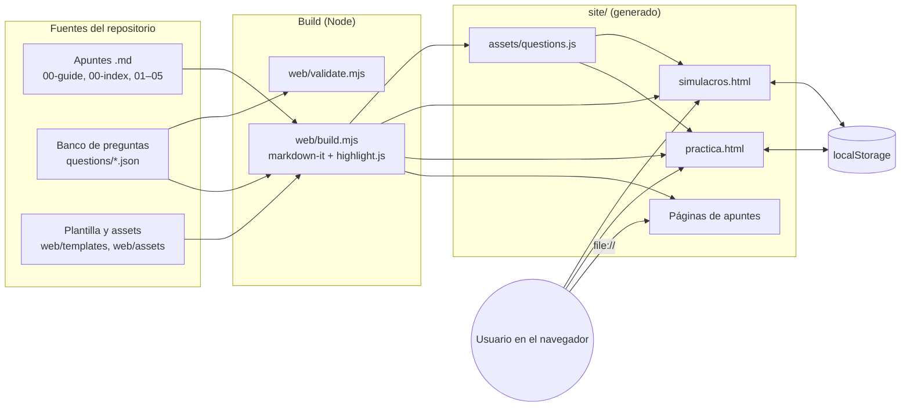

# CCAR-F: apuntes y simulador de examen

Material de estudio personal, en español, para la certificación **Claude Certified Architect – Foundations (CCAR-F)** de Anthropic. Incluye apuntes en Markdown por dominio y una web estática, generada a partir de ellos, con práctica por *task statement* y simulacros de examen cronometrados.

## Descripción funcional

El repositorio tiene dos partes:

- **Apuntes en Markdown** (`00-guide.md`, `00-index.md` y `01`–`05-*.md`). Son la fuente del contenido. Hay una síntesis por cada uno de los cinco dominios de la guía oficial del examen, un índice de recursos por *task statement* y una guía de estudio. Se pueden leer directamente, por ejemplo en Obsidian.
- **Web de estudio** generada con `npm run build` en la carpeta `site/`. Muestra los apuntes como páginas navegables, añade un modo de práctica y simulacros con el formato del examen real: 60 preguntas, 120 minutos, 4 escenarios de 6 y aprobado con 720 sobre 1.000.

La web funciona abriendo los archivos directamente en el navegador (`file://`), sin servidor. No tiene usuarios ni autenticación, y el progreso se guarda en el `localStorage` del navegador.

> **Regla del repositorio:** el contenido de cada `.md` tiene que coincidir con el de su página en la web. Los cambios se hacen en el `.md` y después se regenera la web con `npm run build`; nunca se edita a mano el HTML de `site/`. Los detalles están en [CLAUDE.md](CLAUDE.md).

## Funcionalidades principales

- **Apuntes navegables.** Cada `.md` se convierte en una página con un índice lateral y una barra de lectura. Incluye resaltado de código, diagramas Mermaid y tema claro u oscuro. Los wikilinks de Obsidian entre apuntes se convierten en enlaces.
- **Enlaces entre apuntes y preguntas.** Cada sección `## N.M` de los apuntes lleva un enlace «Practicar N.M». Cada pregunta enlaza a su vez con la sección de los apuntes donde se estudia ese tema.
- **Práctica.** Se puede practicar por *task*, por dominio o solo con las preguntas falladas. Cada respuesta se corrige al momento y se muestra la explicación y por qué falla cada opción incorrecta.
- **Simulacros.** Hay un modo completo y otro corto. Las preguntas se agrupan por escenario y se reparten según el peso de cada dominio. El examen tiene temporizador y permite marcar preguntas para revisarlas. Usa una semilla, así que se puede repetir exactamente el mismo examen.
- **Informe del simulacro.** Muestra una nota orientativa sobre 1.000, los aciertos por dominio y por *task*, la revisión de cada pregunta y el historial de intentos con una gráfica de evolución.
- **Preguntas en inglés con traducción.** Están en inglés, como en el examen real, y tienen un botón para verlas en español.
- **Banco de 240 preguntas** (8 por *task*): 77 originales revisadas y 163 generadas pendientes de revisión.
- **Exportar e importar el progreso** en JSON, para hacer copias o pasarlo a otro navegador.
- **Estilos de impresión** para guardar los apuntes en PDF.

## Arquitectura



El proceso funciona así:

1. `web/build.mjs` lee los `.md` y los convierte a HTML con markdown-it. El resaltado de código lo hace highlight.js durante el build. Las páginas se montan con `web/templates/page.html`.
2. El mismo script lee `questions/bank.json`, `questions/domains.json` y `questions/scenarios.json` y escribe `site/assets/questions.js`. Las preguntas se cargan con una etiqueta `<script>` y no con `fetch()`, porque `fetch()` no funciona con `file://`.
3. Copia los assets de `web/assets/` y, si algún apunte tiene diagramas, `mermaid.min.js` desde `node_modules`. Al terminar comprueba que todos los enlaces internos existen.
4. En el navegador, `practice.js` y `exam.js` leen las preguntas y guardan el progreso en `localStorage`.

La web no se comunica con ningún servicio ni API externa: todo funciona en local. Los enlaces a la documentación de Anthropic que aparecen en los apuntes son enlaces normales.

## Tecnologías principales

- **Node.js** (ES modules) para el build y la validación.
- **[markdown-it](https://github.com/markdown-it/markdown-it)** para convertir el Markdown a HTML.
- **[highlight.js](https://highlightjs.org/)** para el resaltado de código, que se aplica durante el build.
- **[Mermaid](https://mermaid.js.org/)** para los diagramas, que se dibujan en el navegador.
- HTML, CSS y JavaScript sin frameworks en la web generada.

## Requisitos previos

- **Node.js 20 o superior** (`"engines": { "node": ">=20" }` en `package.json`).
- **npm**, porque el repositorio usa `package-lock.json`.
- **make** (opcional), para usar los atajos del [`Makefile`](Makefile). Todo se puede hacer también con `npm`.
- Un navegador moderno.

## Configuración

No hay variables de entorno ni archivos de configuración que preparar. La configuración del contenido está en estos archivos:

| Archivo | Para qué sirve |
|---|---|
| [`questions/domains.json`](questions/domains.json) | Dominios, pesos, *task statements* y archivo de apuntes de cada dominio |
| [`questions/scenarios.json`](questions/scenarios.json) | Los 6 escenarios de la guía del examen |
| [`questions/bank.json`](questions/bank.json) | Banco de preguntas. Es la fuente única de las preguntas |

## Levantar la aplicación en local

Ejecuta los comandos desde la raíz del repositorio.

**Con make**, en un solo paso: instala las dependencias si hace falta, genera la web y la abre en el navegador:

```bash
make open
```

**Con npm**, paso a paso:

1. Instala las dependencias (solo la primera vez o cuando cambie `package-lock.json`):

   ```bash
   npm install
   ```

2. Genera la web:

   ```bash
   npm run build
   ```

   El comando termina indicando si todos los enlaces internos son correctos y cuántas preguntas se han incluido.

3. Abre `site/index.html` en el navegador, por ejemplo con doble clic. No hace falta servidor.

Cada vez que cambies un `.md`, el banco de preguntas o algo de `web/`, vuelve a generar la web con `make build` o `npm run build` y recarga la página.

## Ejecución con Docker

El repositorio no tiene `Dockerfile` ni archivo de Docker Compose. La web es estática y se abre directamente desde `site/`.

## Acceso a la aplicación

Después del build, abre en el navegador los archivos de `site/`. Todas las páginas comparten la barra lateral de navegación.

- **Inicio:** `site/index.html`.
- **Práctica:** `site/practica.html` o el enlace «Practicar N.M» que hay en cada sección de los apuntes.
- **Simulacros:** `site/simulacros.html`. Por defecto solo usa las preguntas revisadas. Para incluir las generadas, marca «Incluir preguntas sin revisar» en *Opciones*.

No hay login. El progreso, el idioma y el tema se guardan en el navegador que uses. Para pasarlos a otro navegador, usa «Guardar o recuperar tu progreso», que está al final de Práctica y de Simulacros.

## Rutas principales

Son páginas estáticas dentro de `site/`:

| Página | Parámetro o ancla | Finalidad |
|---|---|---|
| `index.html` | — | Inicio: guía de estudio (`00-guide.md`) |
| `00-index.html` | — | Índice de recursos por *task statement* (`00-index.md`) |
| `01-agentic-architecture.html` … `05-context.html` | `#<sección>` | Apuntes de cada dominio |
| `practica.html` | — | Resumen de la práctica por dominio y *task* |
| `practica.html` | `?task=1.3` | Practicar un *task statement* |
| `practica.html` | `?domain=d1` | Practicar un dominio completo |
| `practica.html` | `?fallos` | Repasar las preguntas falladas |
| `simulacros.html` | — | Portada de los simulacros con el historial |
| `simulacros.html` | `#examen` | Simulacro en curso |
| `simulacros.html` | `#informe/<id>` | Informe de un simulacro terminado |

## Estructura del repositorio

```text
.
├── 00-guide.md                    # Guía de estudio y recursos (portada de la web)
├── 00-index.md                    # Índice de recursos por task statement
├── 01-agentic-architecture.md     # Dominio 1
├── 02-mcp-tools.md                # Dominio 2
├── 03-claude.md                   # Dominio 3
├── 04-prompt-structured-output.md # Dominio 4
├── 05-context.md                  # Dominio 5
├── CLAUDE.md                      # Convenciones del repositorio y reglas de trabajo
├── README.md                      # Este documento
├── exams/
│   └── examen 1.html              # Examen original de 77 preguntas (fuente de las preguntas ex1-*)
├── questions/
│   ├── bank.json                  # Banco de preguntas (fuente única)
│   ├── domains.json               # Dominios, pesos y task statements
│   └── scenarios.json             # Escenarios de la guía
├── resources/                     # PDFs de referencia (guía oficial del examen y e-book de agentes)
├── web/
│   ├── build.mjs                  # Genera site/ desde los .md y el banco
│   ├── validate.mjs               # Valida el banco de preguntas
│   ├── extract-exam1.mjs          # Extrae las preguntas de exams/examen 1.html
│   ├── templates/page.html        # Plantilla común de las páginas
│   └── assets/                    # app.js, util.js, practice.js, exam.js, style.css y favicon
├── Makefile                       # Atajos: make build, make open, make check…
├── package.json                   # Scripts y dependencias
└── package-lock.json
```

`site/` y `node_modules/` se generan y están en `.gitignore`.

## Comandos útiles

Ejecútalos desde la raíz del repositorio. `make` sin argumentos muestra la lista de atajos.

### Con make

| Comando | Qué hace |
|---|---|
| `make` o `make help` | Muestra los atajos disponibles |
| `make install` | Instala las dependencias (`npm install`); solo vuelve a hacerlo si cambian `package.json` o `package-lock.json` |
| `make build` | Genera la web en `site/` y comprueba los enlaces internos; instala antes las dependencias si faltan |
| `make validate` | Valida el banco de preguntas |
| `make check` | Valida el banco y genera la web |
| `make open` | Genera la web y abre `site/index.html` en el navegador (`xdg-open` en Linux, `open` en macOS) |
| `make clean` | Borra la web generada (`site/`) |
| `make rebuild` | Borra `site/` y la vuelve a generar |
| `make extract-exam1` | Extrae las 77 preguntas de `exams/examen 1.html`; no sobrescribe `questions/bank.json` si ya existe |

### Con npm

| Comando | Qué hace |
|---|---|
| `npm install` | Instala las dependencias |
| `npm run build` | Genera la web en `site/` y comprueba los enlaces internos |
| `npm run validate` | Valida el banco de preguntas y muestra cuántas hay por dominio, *task* y escenario |
| `npm run validate -- --quiet` | Lo mismo, con una salida más reducida |
| `npm run extract:exam1` | Vuelve a extraer las 77 preguntas de `exams/examen 1.html`. No sobrescribe `questions/bank.json` sin `--force` |

> `npm run extract:exam1 -- --force` reemplaza el banco completo por las 77 preguntas originales y **se pierden las 163 generadas** y cualquier cambio posterior. Úsalo solo si sabes lo que haces.

## Pruebas y calidad

No hay tests automáticos, linter ni integración continua. Las comprobaciones disponibles son:

- **`npm run validate`.** Falla, con código de salida 1, si hay errores en el banco: ids repetidos, una *task* que no pertenece a su dominio, un escenario o un origen desconocido, respuestas incoherentes con el tipo de pregunta, o letras de la traducción o de las explicaciones que no existen. Avisa, sin fallar, de las preguntas sin revisar, las traducciones o explicaciones por opción que faltan y las *tasks* con menos de 8 preguntas.
- **`npm run build`.** Comprueba que todos los enlaces internos y anclas de las páginas generadas existen.

### Añadir o revisar preguntas

- Las preguntas nuevas usan ids `gen-<task>-NN` (por ejemplo, `gen-4.3-09`). No se cambian los ids existentes, porque el progreso guardado en el navegador va asociado a ellos.
- Cada pregunta tiene el texto en inglés y los campos `*_es` con la traducción.
- Las preguntas generadas llevan `"reviewed": false`. Cuando revises una, cambia el valor a `true`.
- Después ejecuta `make check` (o `npm run validate` y `npm run build`).

## Licencia

El repositorio no incluye ningún archivo de licencia.
